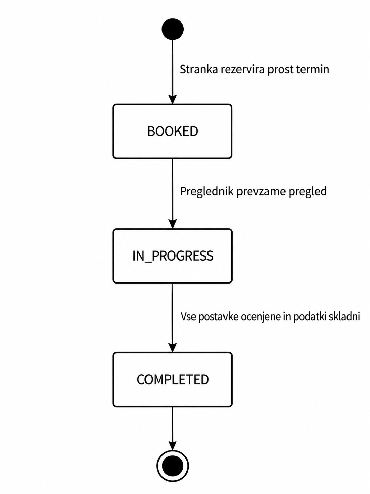

# AutoCheck – funkcionalnosti in obseg

## Uporabniške vloge

Vsak uporabnik ima natanko eno vlogo. Strežnik preverja tako vlogo kot dovoljen dostop do konkretnega zapisa; skrivanje gumbov v brskalniku ni zadostna zaščita.

| Vloga | Dovoljena dejanja | Omejitve |
| --- | --- | --- |
| Stranka (`CUSTOMER`) | Registracija, vnos in popravek lastnih vozil, rezervacija prostega termina, vpogled v lastne rezervacije in zaključene preglede. | Ne vidi tujih vozil ali pregledov, ne ustvarja prostih terminov, ne izvaja pregledov in ne izbira svoje vloge. |
| Preglednik (`INSPECTOR`) | Pregled razporeda postaje in podatkov vozil za naročene preglede, prevzem rezervacije, izpolnjevanje in zaključek lastnega aktivnega pregleda. | Ne upravlja uporabnikov, prostih terminov ali predloge; ne spreminja pregleda drugega preglednika ali zaključenih pregledov. Ne dostopa do celotne zbirke uporabniških računov. |
| Administrator (`ADMIN`) | V MVP ustvarja proste termine in bere vsa vozila, rezervacije in preglede. V nadaljnji različici upravlja račune, prihodnje proste termine in predlogo ter spremlja statistiko. | Ne izvaja pregledov in ne spreminja njihovih strokovnih ugotovitev. Ne more obiti pravil zasedenosti termina ali spreminjati zaključenih pregledov; gesel ne vidi v berljivi obliki. |

Registracijo in prijavo zagotavlja Supabase Auth. Nov uporabniški profil vedno dobi vlogo stranke. Začetna računa administratorja in preglednika razvijalec pripravi v nadzorni plošči Supabase ter njuni vlogi nastavi v bazi. Upravljanje računov prek uporabniškega vmesnika AutoCheck je nadgradnja F08.

## Predvidene funkcionalnosti

Načrt obsega **12 funkcionalnosti**, od tega **7 za MVP**. F03–F07 so domensko specifične. Funkcionalnosti F08–F12 niso pogoj za prvo delujočo različico.

| ID | Funkcionalnost | Vsebina in preverljiv rezultat | Obseg |
| --- | --- | --- | --- |
| F01 | Dostop glede na vlogo | Stranka se registrira in prijavi; vse tri vloge dobijo ustrezne strani in strežniško preverjene pravice. Poskus dostopa do tujega zapisa je zavrnjen. | **MVP** |
| F02 | Evidenca lastnih vozil | Stranka vnese registrsko oznako, VIN, proizvajalca, model in letnik ter popravi podatke, dokler vozilo nima rezervacije. Administrator ima bralni vpogled v vsa vozila. | **MVP** |
| F03 | Objava in rezervacija termina | Administrator ustvari prihodnji 30-minutni termin; stranka ga rezervira za svoje vozilo. Sistem prepreči prekrivanje terminov, dvojno rezervacijo in več odprtih rezervacij istega vozila. | **MVP** |
| F04 | Prevzem in potek pregleda | Stranka vidi svoje prihajajoče rezervacije; preglednik vidi razpored in prevzame rezervacijo. Potek je `BOOKED → IN_PROGRESS → COMPLETED`; pregled lahko ureja samo preglednik, ki ga je začel. | **MVP** |
| F05 | Izpolnjevanje kontrolnega seznama | Ob začetku se kopira sedem prednastavljenih postavk. Preglednik vsaki določi `PASS` ali `FAIL`; ob `NOT_CHECKED` zaključek ni dovoljen. | **MVP** |
| F06 | Evidentiranje napak po postavkah | Preglednik pri neuspešni postavki zapiše eno ali več napak z opisom in resnostjo `MINOR` ali `MAJOR`; do zaključka jih lahko popravi ali odstrani. | **MVP** |
| F07 | Izračun izida in zgodovina vozila | Ob potrditvi zaključka strežnik preveri popolnost pregleda in iz napak izračuna izid. Stranka vidi zaključene preglede svojega vozila z ocenami in napakami; administrator vidi vse preglede. | **MVP** |
| F08 | Upravljanje računov osebja | Administrator ustvari račun preglednika, spremeni vlogo računa brez odprtih obveznosti ali deaktivira račun. Pretekli pregledi ohranijo povezavo na izvajalca. | Kasneje |
| F09 | Urejanje ponudbe prostih terminov | Administrator popravi ali umakne še nezaseden prihodnji termin. Zasedenega termina ne more izbrisati. | Kasneje |
| F10 | Nastavitve kontrolnega seznama | Administrator dodaja, razvršča in deaktivira postavke predloge. Spremembe veljajo samo za na novo začete preglede. | Kasneje |
| F11 | Prestavitev rezervacije | Stranka rezervacijo v stanju `BOOKED` pred začetkom termina prestavi na drug prost prihodnji termin. Zamenjava je atomarna, stari termin se sprosti. | Kasneje |
| F12 | Osnovna statistika postaje | Administrator za izbrano obdobje vidi število zaključenih pregledov in porazdelitev treh izidov. | Kasneje |

## Netrivialen delovni proces

Stanje poteka hrani rezervacija (`Appointment.status`). Pregled (`Inspection`) hrani ugotovitve in končni izid, ki ni isto kot stanje rezervacije.

### Pravila rezervacije in začetka

- Termin traja 30 minut, je v prihodnosti in se ne prekriva z drugim terminom. Ena rezervacija zasede cel termin.
- Stranka lahko rezervira samo lastno vozilo. Vozilo ima lahko največ eno rezervacijo v stanju `BOOKED` ali `IN_PROGRESS`.
- Preglednik lahko prevzame katerokoli rezervacijo postaje v stanju `BOOKED`, od časa začetka njenega termina naprej. Pri zamudi jo lahko prevzame tudi kasneje; sistem je ne odpove samodejno.
- V MVP lahko na enem preglednem mestu poteka samo en pregled hkrati. Morebitna zamuda ne spreminja časa naslednjih rezervacij.
- Prevzem v eni podatkovni transakciji spremeni stanje, določi preglednika ter ustvari pregled in kopije aktivnih postavk predloge. Sočasen drugi prevzem je zavrnjen.

### Pravila ocenjevanja in zaključka

- Začetna ocena vsake postavke je `NOT_CHECKED`.
- Postavka `FAIL` mora ob zaključku imeti vsaj eno napako; postavka `PASS` ne sme imeti napak. Med izpolnjevanjem je začasno nepopoln zapis dovoljen.
- Napaka ima neprazen opis in resnost `MINOR` ali `MAJOR`. Nanaša se na postavko istega pregleda.
- Zaključek je dovoljen samo izvajalcu aktivnega pregleda, ko ni več neocenjenih postavk in so vse napake skladne z ocenami.
- Strežnik v isti transakciji izračuna in shrani izid, nastavi `completedAt` ter stanje rezervacije spremeni v `COMPLETED`. Odjemalec ne določa končnega izida.
- Zaključenih pregledov, postavk in napak ni dovoljeno spreminjati ali brisati. Ponoven zahtevek za zaključek se zavrne brez spremembe podatkov.

| Pogoj ob zaključku, preverjen po vrstnem redu | Končni izid |
| --- | --- |
| Obstaja vsaj ena napaka `MAJOR`. | `FAILED` |
| Ni napake `MAJOR`, obstaja pa vsaj ena napaka `MINOR`. | `REINSPECTION_REQUIRED` |
| Ni napak in vse postavke imajo `PASS`. | `PASSED` |

To je izključno poenostavljeno pravilo učne aplikacije, ne razlaga uradnih meril tehničnih pregledov. Oznaka `REINSPECTION_REQUIRED` sama ne ustvari nove rezervacije. Stranka lahko po zaključku sama rezervira nov običajen pregled; povezovanje ponovnih pregledov ni del MVP.

## Kasnejše nadgradnje

Po delujočem MVP je predvidenih najmanj pet samostojnih nadgradenj:

1. Upravljanje in deaktivacija uporabniških računov prek administratorskega vmesnika (F08).
2. Urejanje in umik nezasedenih terminov (F09).
3. Upravljanje vsebine in vrstnega reda kontrolnega seznama (F10).
4. Prestavitev še nezačetega termina s sprostitvijo starega (F11).
5. Statistika opravljenih pregledov po obdobju in izidu (F12).

## Izven obsega projekta (out of scope)

- Povezovanje z državnimi evidencami vozil ali preverjanje lastništva v zunanjih registrih.
- Uradna potrdila, pravno veljavni zapisniki in odločanje o zakonski tehnični brezhibnosti.
- Spletna plačila, ceniki, izdajanje računov in računovodstvo.
- Povezovanje z merilnimi napravami ter samodejni zajem emisij ali zavornih meritev.
- Več poslovalnic, več sočasnih preglednih mest in samodejno razporejanje zaposlenih.
- Obvestila po e-pošti ali SMS, samostojna mobilna aplikacija in nalaganje fotografij.
- Odpovedi rezervacij, čakalne vrste, posebna obravnava neprihoda in povezan proces ponovnega pregleda.
- Prenos vozila med lastniki, brisanje zgodovine in popravljanje že zaključenih pregledov.

## Preverjanje zahtev naloge

| Zahteva | Pokritje |
| --- | --- |
| Dinamična spletna rešitev | Obrazci in strani uporabljajo REST API ter PostgreSQL; dokument 04. |
| Vsaj tri vloge | `CUSTOMER`, `INSPECTOR`, `ADMIN`; tabela vlog zgoraj. |
| Vsaj tri povezane entitete in trajno shranjevanje | Osem povezanih aplikacijskih tabel v PostgreSQL na Supabase; dokument 03. |
| Osnovna avtentikacija in upravljanje uporabnikov | F01, začetna računa osebja in strežniško preverjanje pravic. |
| Netrivialen proces | Rezervacija, atomaren prevzem, ocenjevanje, validacija in zaključek. |
| 10–15 funkcionalnosti | 12 funkcionalnosti F01–F12. |
| 5–7 funkcionalnosti MVP, vsaj tri domenske | Sedem funkcionalnosti MVP; pet domenskih F03–F07. |
| Vsaj pet nadgradenj | F08–F12. |
| Vsaj tri funkcionalnosti izven obsega | Osem alinej zgoraj. |
| Nadaljnji razvoj | Ločen frontend in API, relacijski model, shranjene SQL spremembe in kopije postavk pregledov. |
