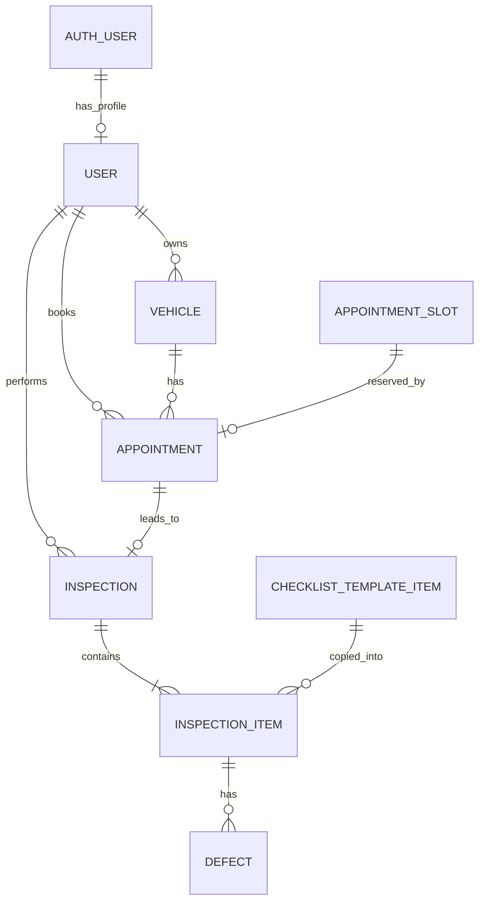

# AutoCheck – podatkovni model

## Osnovna zasnova

Podatki se shranjujejo v **PostgreSQL, ki gostuje na Supabase**. Model ima osem aplikacijskih tabel; Supabase poleg njih upravlja svoje tabele za prijavo. Poleg šestih vsebinskih entitet iz ideje sta potrebni tabela prostih terminov in predloga kontrolnega seznama: prost termin obstaja že pred rezervacijo, predloga pa že pred prvim pregledom.

Imena spodaj so logična imena entitet in polj. V bazi naj bodo tabele in stolpci zapisani v obliki `snake_case` (npr. `inspection_items`, `inspection_id`). Primarni ključi so `uuid`; časovna polja so `timestamptz`. Obvezna so vsa polja, razen izrecno navedenih kot neobvezna. Nizi s končnim naborom vrednosti se omejijo s SQL `CHECK` omejitvami.

## Entitete in glavna polja

### 1. User – uporabniški profil (`profiles`)

| Polje | Tip in omejitve | Namen |
| --- | --- | --- |
| `id` | `uuid`, PK in FK → `auth.users.id` | Isti identifikator kot pri računu Supabase Auth. |
| `name` | `varchar(100)` | Ime za prikaz. |
| `role` | `varchar`, CHECK | `CUSTOMER`, `INSPECTOR`, `ADMIN`; nov profil dobi `CUSTOMER`. |
| `createdAt` | `timestamptz` | Čas ustvaritve. |

E-poštni naslov in geslo upravlja **Supabase Auth**; v aplikacijsko tabelo ju ne podvajamo. Po prvi uspešni prijavi backend na zahtevo `POST /api/auth/profile` ustvari profil na podlagi preverjenega uporabnika. Ponovljena zahteva obstoječega profila ali njegove vloge ne spremeni. Vloge ni mogoče podati ob registraciji. V nadaljevanju povezava na `User` vedno pomeni povezavo na `profiles.id`. Ločen profil, povezan s primarnim ključem računa, sledi [zasnovi uporabniških podatkov Supabase](https://supabase.com/docs/guides/auth/managing-user-data).

### 2. Vehicle – vozilo (`vehicles`)

| Polje | Tip in omejitve | Namen |
| --- | --- | --- |
| `id` | `uuid`, PK | Identifikator vozila. |
| `ownerId` | `uuid`, FK → User | Stranka, ki je vnesla vozilo. |
| `registrationNumber` | `varchar(20)`, UNIQUE | Registrska oznaka. |
| `manufacturer` | `varchar(60)` | Proizvajalec. |
| `model` | `varchar(60)` | Model vozila. |
| `year` | `smallint` | Letnik; API preveri razpon od 1900 do trenutnega leta + 1. |
| `vin` | `varchar(17)`, UNIQUE, dolžina 17 | VIN, velike črke; dovoljena so števila in črke brez I, O, Q. |

Registrska oznaka se pred primerjavo shrani z velikimi črkami brez presledkov in vezajev. Vnos lastništva je uporabnikova navedba; ni preverjanja v uradni evidenci. Lastnika ni mogoče spremeniti. V MVP so popravki podatkov vozila dovoljeni samo, dokler nima nobene rezervacije, zato se prikaz vozila v zgodovini ne spreminja za nazaj.

### 3. AppointmentSlot – razpoložljivi termin (`appointment_slots`)

| Polje | Tip in omejitve | Namen |
| --- | --- | --- |
| `id` | `uuid`, PK | Identifikator ponujenega termina. |
| `startsAt` | `timestamptz`, UNIQUE | Začetek termina. |
| `endsAt` | `timestamptz` | Konec, natanko 30 minut po začetku. |

Termin je prost, če nanj ni vezana rezervacija in se še ni začel. Ločenega polja `isAvailable` ni. Vsi termini pripadajo isti postaji in enemu preglednemu mestu. Trajanje se preveri s `CHECK`; prekrivanje se prepreči z izključitveno omejitvijo nad `tstzrange(starts_at, ends_at, '[)')` z operatorjem `&&`. Zaporedna termina se smeta stikati na meji.

### 4. Appointment – rezervacija (`appointments`)

| Polje | Tip in omejitve | Namen |
| --- | --- | --- |
| `id` | `uuid`, PK | Identifikator rezervacije. |
| `slotId` | `uuid`, FK → AppointmentSlot, UNIQUE | Rezervirani termin; največ ena rezervacija na termin. |
| `vehicleId` | `uuid`, FK → Vehicle | Naročeno vozilo. |
| `customerId` | `uuid`, FK → User | Stranka, ki je rezervirala termin. |
| `status` | `varchar`, CHECK | `BOOKED`, `IN_PROGRESS`, `COMPLETED`; privzeto `BOOKED`. |
| `createdAt` | `timestamptz` | Čas rezervacije. |

`customerId` določi API iz prijavljenega uporabnika in preveri, da je lastnik vozila. Čas rezerviranega pregleda se pridobi prek `slotId`; polja `scheduledAt` ne podvajamo. Delni enolični indeks nad `vehicleId` za stanji `BOOKED` in `IN_PROGRESS` zagotavlja največ eno odprto rezervacijo vozila. Dodaten delni enolični indeks nad `status`, kjer je stanje `IN_PROGRESS`, omeji postajo na en aktiven pregled.

### 5. Inspection – pregled (`inspections`)

| Polje | Tip in omejitve | Namen |
| --- | --- | --- |
| `id` | `uuid`, PK | Identifikator pregleda. |
| `appointmentId` | `uuid`, FK → Appointment, UNIQUE | Rezervacija, iz katere je nastal pregled. |
| `inspectorId` | `uuid`, FK → User | Preglednik, ki je prevzel pregled. |
| `startedAt` | `timestamptz` | Čas začetka. |
| `completedAt` | `timestamptz`, neobvezno | Čas zaključka; pred zaključkom `NULL`. |
| `finalResult` | `varchar`, CHECK, neobvezno | `PASSED`, `FAILED`, `REINSPECTION_REQUIRED`; pred zaključkom `NULL`. |
| `notes` | `text`, neobvezno | Splošna opomba preglednika. |

Vozilo je določeno prek rezervacije, zato `vehicleId` ni podvojen tudi na pregledu. `completedAt` in `finalResult` morata biti oba prazna ali oba izpolnjena; čas zaključka ne sme biti pred začetkom. Stanje poteka se bere iz rezervacije.

| `Appointment.status` | Povezani `Inspection` | `completedAt` in `finalResult` |
| --- | --- | --- |
| `BOOKED` | Še ne obstaja. | Ni zapisa pregleda. |
| `IN_PROGRESS` | Obstaja natanko en pregled z izvajalcem, časom začetka in postavkami. | Obe polji sta `NULL`. |
| `COMPLETED` | Obstaja isti, zaključen pregled. | Obe polji sta izpolnjeni; izid je lahko katerikoli od treh dovoljenih izidov. |

Te povezave med stanjem rezervacije in pregledom zagotovi backend v transakcijah začetka in zaključka. `Inspection` nima dodatnega polja `status`. Pravila za izračun `finalResult` so določena v [dokumentu 02](02-funkcionalnosti-in-obseg.md#pravila-ocenjevanja-in-zaključka).

### 6. ChecklistTemplateItem – postavka predloge (`checklist_template_items`)

| Polje | Tip in omejitve | Namen |
| --- | --- | --- |
| `id` | `uuid`, PK | Identifikator postavke predloge. |
| `category` | `varchar(60)` | Npr. Zavore, Luči, Pnevmatike. |
| `name` | `varchar(150)` | Jasno navodilo za preverjanje. |
| `sortOrder` | `integer`, UNIQUE | Vrstni red prikaza. |
| `isActive` | `boolean`, privzeto `true` | Ali se postavka kopira v nove preglede. |

Začetna datoteka `database/schema.sql` bo pripravila po eno postavko za zavore, luči, pnevmatike, krmiljenje, vzmetenje, emisije in identifikacijo vozila. Upravljanje predloge prek aplikacije pride kasneje (F10); pripravljena polja podpirajo to nadgradnjo.

### 7. InspectionItem – ocenjevana postavka (`inspection_items`)

| Polje | Tip in omejitve | Namen |
| --- | --- | --- |
| `id` | `uuid`, PK | Identifikator postavke pregleda. |
| `inspectionId` | `uuid`, FK → Inspection | Pregled, ki mu postavka pripada. |
| `templateItemId` | `uuid`, FK → ChecklistTemplateItem | Izvorna postavka predloge. |
| `category` | `varchar(60)` | Kopija kategorije ob začetku. |
| `name` | `varchar(150)` | Kopija besedila ob začetku. |
| `sortOrder` | `integer` | Kopija vrstnega reda ob začetku. |
| `result` | `varchar`, CHECK | `PASS`, `FAIL`, `NOT_CHECKED`; privzeto `NOT_CHECKED`. |
| `notes` | `text`, neobvezno | Opomba k preverjanju. |

Par `(inspectionId, templateItemId)` je enoličen. Kopije besedil ohranijo prvotno vsebino pregleda tudi ob kasnejši spremembi predloge. Ob začetku mora obstajati vsaj ena aktivna postavka; po začetku se nabor postavk tega pregleda ne spreminja.

### 8. Defect – napaka (`defects`)

| Polje | Tip in omejitve | Namen |
| --- | --- | --- |
| `id` | `uuid`, PK | Identifikator napake. |
| `inspectionItemId` | `uuid`, FK → InspectionItem | Postavka, pri kateri je napaka ugotovljena. |
| `description` | `text`, neprazno | Opis konkretne ugotovitve. |
| `severity` | `varchar`, CHECK | `MINOR` (manjša) ali `MAJOR` (večja napaka); izbere preglednik. |

Pregled se določi prek postavke; ločen `inspectionId` bi podvajal povezavo. Ena postavka ima lahko več napak. Ob zaključku mora imeti postavka z napakami oceno `FAIL`, postavka `PASS` pa nobene napake. Backend pri izračunu končnega izida upošteva napake vseh postavk istega pregleda.

## Povezave in osnutek modela

- Račun Supabase Auth ima 0–1 aplikacijski profil; profil nastane po prvi prijavi in je obvezen za uporabo funkcij AutoCheck.
- Uporabnik kot stranka ima 0–N vozil in rezervacij; kot preglednik izvede 0–N pregledov.
- Vozilo ima 0–N rezervacij skozi čas, vendar največ eno odprto.
- Termin ima 0–1 rezervacijo; vsaka rezervacija zaseda natanko en termin.
- Rezervacija ima pred začetkom 0 pregledov, po začetku natanko 1.
- Pregled ima 1–N postavk; postavka pripada natanko enemu pregledu in ima 0–N napak.
- Ena postavka predloge je izvor za 0–N kopij v pregledih.

## Celovitost in transakcije

Tuji ključi uporabljajo `ON DELETE RESTRICT`; brisanje vozil, uporabnikov, rezervacij in pregledov ni del MVP. Brisanje napake je dovoljeno samo med aktivnim pregledom. API nikoli ne omogoči neposrednega spreminjanja stanja rezervacije mimo namenskih dejanj.

Rezervacija termina, prevzem pregleda in njegov zaključek so ločene transakcije. Pri rezervaciji API zaklene izbrani termin in znova preveri razpoložljivost. Pri začetku, urejanju postavk ali napak in zaključku zaklene pripadajočo rezervacijo z `SELECT … FOR UPDATE`, nato preveri trenutno stanje in izvajalca. Tako zaključek ne more tekmovati z istočasnim spreminjanjem ugotovitev.

Baza uveljavlja ključe, dovoljene vrednosti in enoličnost. Backend dodatno preveri vloge, lastništvo, dovoljene prehode stanj, popolnost kontrolnega seznama in pravila izida iz [dokumenta 02](02-funkcionalnosti-in-obseg.md). Kršitev zaradi sočasne rezervacije ali prevzema se vrne kot konflikt, brez delnega zapisa.

Za iskanje se poleg indeksov ključev predvidijo indeksi nad `Vehicle.ownerId`, `Appointment.customerId`, `Appointment.vehicleId`, `Inspection.inspectorId`, `InspectionItem.inspectionId` in `Defect.inspectionItemId`.

## Preprosta priprava baze

Ob implementaciji pripravimo eno datoteko **`database/schema.sql`** s tabelami, povezavami, omejitvami in sedmimi začetnimi postavkami. Izvedemo jo enkrat v SQL Editorju projekta Supabase. Lokalna namestitev PostgreSQL, Docker in posebno orodje za migracije niso potrebni.

Poznejšo spremembo, npr. dodajanje `User.isActive` za F08, shranimo kot kratko SQL datoteko v `database/changes/` in jo izvedemo v istem urejevalniku. Datoteke oštevilčimo po vrstnem redu ter v README zabeležimo izvedene spremembe. Začetne sheme ne izvajamo ponovno čez obstoječe podatke. To je preprosto beleženje sprememb baze; Supabase teh sprememb ne pripravi samodejno.

Podatki ostanejo v gostovani bazi tudi po ustavitvi lokalne aplikacije. Do njih dostopa Express backend; neposredni Supabase Data API bo izključen, kot je opisano v [dokumentu 04](04-arhitektura-in-tehnoloski-sklad.md).
