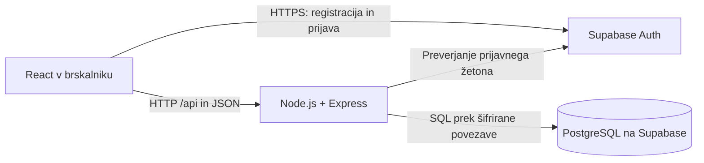

# AutoCheck – arhitektura in tehnološki sklad

## Glavni deli sistema

AutoCheck uporablja **React za uporabniški vmesnik, majhen Express backend in Supabase za bazo ter prijavo**. Frontend in backend tečeta lokalno, baza in prijavna storitev pa na Supabase. Za razvoj potrebujemo internetno povezavo.

1. **Frontend:** obrazci in strani za vozila, rezervacije in preglede. Prijavo opravi prek Supabase Auth, podatke AutoCheck pa pridobi prek lastnega REST API.
2. **Backend:** preveri prijavo, vloge in lastništvo podatkov; izvede rezervacijo, začetek pregleda in izračun izida.
3. **Supabase:** gosti PostgreSQL in zagotavlja Supabase Auth za registracijo, prijavo ter upravljanje gesel.



**Docker ni zahteva fakultetne naloge in ga ta zasnova ne uporablja.** Lokalni zagon pomeni zagon spletnega vmesnika in backenda na računalniku; baze ni treba nameščati lokalno.

## Tehnologije in utemeljitev izbire

| Del | Tehnologija | Zakaj |
| --- | --- | --- |
| Frontend | React, TypeScript, Vite, navaden CSS | Pregledna izdelava obrazcev in strani, enostaven razvojni zagon. |
| Backend | Node.js, Express, TypeScript | Majhen API in poslovna pravila v istem jeziku kot frontend. |
| Podatkovna baza | PostgreSQL na Supabase | Povezane tabele in transakcije brez lokalne namestitve baze. |
| Avtentikacija | Supabase Auth in `@supabase/supabase-js` | Pripravljena registracija in prijava; ne pišemo lastnega shranjevanja gesel ali izdajanja žetonov. |
| Povezava z bazo | `pg` na backendu | Običajne parametrizirane SQL poizvedbe in transakcije. |
| Lokalni razvoj | Node.js, npm, Git, `.env` | Običajna namestitev odvisnosti, zagon in shranjevanje nastavitev. |
| Priprava baze | Supabase SQL Editor in shranjene SQL datoteke | Za majhen projekt ne potrebujemo posebnega orodja za migracije. |

Express ostane zato, da so pravice in pravila pregleda zbrani na enem mestu. Rezervacijo ali zaključek pregleda lahko izvede v eni transakciji: uspejo vse povezane spremembe ali pa nobena. Supabase poenostavi infrastrukturo in prijavo; pravila AutoCheck še vedno implementiramo sami.

Ne uvajamo ORM, mikrostoritev ali dodatnih arhitekturnih plasti. Vhodne podatke preverja backend, omejitve in povezave pa tudi baza. Natančne različice paketov se ob implementaciji shranijo v `package-lock.json`.

## Prijava in pravice uporabnikov

- Frontend uporablja Supabase Auth za registracijo z e-pošto in geslom, prijavo ter odjavo. Za sejo in obnovo žetona skrbi knjižnica Supabase. [Dokumentacija prijave v React aplikaciji](https://supabase.com/docs/guides/auth/quickstarts/react).
- Po uspešni prvi prijavi `POST /api/auth/profile` ustvari aplikacijski profil z vlogo `CUSTOMER`. ID pridobi iz preverjenega žetona, uporabnik pa poda samo ime. Če profil že obstaja, zahteva vrne obstoječega in ne spremeni vloge.
- Frontend ob klicu lastnega API pošlje dostopni žeton v glavi `Authorization: Bearer <token>`. Backend ga preveri s `supabase.auth.getUser(token)`, nato iz tabele `profiles` prebere vlogo. [Preverjanje uporabnika](https://supabase.com/docs/reference/javascript/auth-getuser).
- Stranka dostopa samo do lastnih podatkov, preglednik ureja samo svoj aktivni pregled, administrator pa ima pravice iz [dokumenta 02](02-funkcionalnosti-in-obseg.md). Preverjanje se izvaja na backendu pri vsaki zahtevi.
- Začetna računa osebja razvijalec ustvari v Supabase Auth nadzorni plošči. Nato v tabeli `profiles` pripravi pripadajoča profila z vlogama `ADMIN` in `INSPECTOR`. To je enkratna priprava MVP.

Brskalnik dobi samo URL projekta in javni ključ Supabase (`publishable key`) za prijavo. Povezovalni niz baze ostane v `backend/.env`. **Supabase Data API izključimo**, ker vsi poslovni podatki potujejo prek Express API; s tem se njegovih preverjanj ne da obiti z neposrednimi klici podatkovnega API Supabase. Auth ostane ločena prijavna storitev. [Nastavitev Data API](https://supabase.com/docs/guides/api/securing-your-api#disable-the-data-api).

## Glavne poti REST API

Vse spodnje poti imajo predpono `/api`. Registracija, prijava in odjava se izvajajo prek Supabase Auth, zato zanje ne izdelujemo lastnih poti. Pri vseh zapisih backend preverja pravice iz dokumenta 02.

| Poti | Namen |
| --- | --- |
| `POST /auth/profile`, `GET /auth/me` | Priprava lastnega profila po prijavi in branje trenutne vloge. |
| `GET /vehicles`, `POST /vehicles`, `GET /vehicles/:id`, `PATCH /vehicles/:id` | Lastna vozila stranke; administrator ima bralni dostop do vseh. Popravki samo pred prvo rezervacijo. |
| `GET /slots`, `POST /slots` | Stranka vidi proste prihodnje termine; administrator vidi vse in ustvarja nove. |
| `GET /appointments`, `POST /appointments`, `GET /appointments/:id` | Strankine rezervacije oziroma razpored postaje za osebje; rezervacijo ustvari stranka za lastno vozilo. |
| `POST /appointments/:id/start` | Preglednik prevzame rezervacijo in ustvari pregled s postavkami. |
| `GET /inspections`, `GET /inspections/:id` | Stranka vidi svoje zaključene preglede, preglednik svoje preglede, administrator vse. |
| `PATCH /inspections/:id` | Preglednik popravi opombo lastnega aktivnega pregleda. |
| `PATCH /inspections/:id/items/:itemId` | Preglednik oceni postavko lastnega aktivnega pregleda. |
| `POST /inspections/:id/items/:itemId/defects` | Zapis napake in resnosti na postavki lastnega aktivnega pregleda. |
| `PATCH /inspections/:id/defects/:defectId`, `DELETE /inspections/:id/defects/:defectId` | Popravek ali odstranitev napake pred zaključkom. |
| `POST /inspections/:id/complete` | Preverjanje postavk, izračun izida in zaključek lastnega aktivnega pregleda. |

Rezervacija sprejme `vehicleId` in `slotId`, lastnika določi backend. Postavke nastanejo samodejno ob začetku. Končnega izida in stanja rezervacije ni mogoče neposredno nastaviti s poljubnim zahtevkom. Pri poteh s postavko ali napako se preveri tudi njena pripadnost pregledu.

API vrne jasna sporočila: neveljavni podatki (`400`), neprijavljen uporabnik (`401`), prepovedano dejanje (`403`), neobstoječ ali tuj zapis (`404`) ter zaseden termin ali nedovoljen prehod stanja (`409`).

Nadgradnje F08–F12 bodo dodale poti za upravljanje osebja, urejanje prostih terminov in predloge, prestavitev rezervacije ter statistiko. Ustvarjanje računov osebja prek aplikacije bo pri F08 uporabljalo Supabase Auth Admin API samo na backendu; administratorski ključ ne sodi v frontend.

## Priprava baze in spremembe sheme

V projektu Supabase enkrat izvedemo datoteko `database/schema.sql` prek **SQL Editorja**. V njej bodo tabele iz dokumenta 03, povezave, omejitve in začetne postavke kontrolnega seznama. Začetna računa osebja pripravimo ločeno, kot je opisano zgoraj.

Če kasneje dodamo polje ali tabelo, SQL spremembo shranimo v `database/changes/`, npr. `01-add-user-active.sql`, ter jo izvedemo v SQL Editorju. V README zabeležimo vrstni red in že izvedene spremembe. Tako ostane priprava ponovljiva brez avtomatskega sistema migracij. **Supabase olajša upravljanje baze, ne nadomesti pa beleženja sprememb njene strukture.**

## Predlagana struktura projekta

```text
AutoCheck/
├── docs/                    # štirje dokumenti zasnove
├── frontend/
│   ├── src/
│   │   ├── pages/
│   │   ├── components/
│   │   ├── api.ts           # klici Express API
│   │   └── supabase.ts      # prijava in seja
│   ├── .env.example
│   └── package.json
├── backend/
│   ├── src/
│   │   ├── routes/
│   │   ├── services/        # pravila in SQL poizvedbe
│   │   ├── auth.ts          # preverjanje prijave in pravic
│   │   ├── db.ts
│   │   └── server.ts
│   ├── .env.example
│   └── package.json
├── database/
│   ├── schema.sql
│   └── changes/             # samo ob poznejših spremembah baze
├── .gitignore
└── README.md
```

To je predlog za kasnejšo implementacijo. Trenutno so ustvarjeni samo dokumenti v `docs/`.

## Lokalni zagon

Predpogoji so Node.js z npm, internetna povezava in pripravljen projekt Supabase. Docker, Supabase CLI in lokalni PostgreSQL niso potrebni.

1. V Supabase pripravimo bazo z `schema.sql`, izključimo Data API in omogočimo prijavo z e-pošto ter geslom. Za lokalni naslov aplikacije nastavimo `http://localhost:5173`; če je vključena potrditev e-pošte, jo uporabnik opravi pred prvo prijavo.
2. Iz `.env.example` pripravimo `.env` v obeh delih aplikacije. Frontend potrebuje `VITE_SUPABASE_URL` in `VITE_SUPABASE_PUBLISHABLE_KEY`; backend `SUPABASE_URL`, `SUPABASE_PUBLISHABLE_KEY`, `DATABASE_URL` in `PORT=3000`. Dejanske datoteke `.env` se ne shranijo v Git.
3. Povezovalni niz baze kopiramo iz Supabase možnosti **Connect → Session pooler**. Backend uporablja šifrirano povezavo s preverjanjem certifikata. Ta način omogoča povezavo tudi iz omrežja IPv4. [Povezava na PostgreSQL](https://supabase.com/docs/guides/database/connecting-to-postgres).
4. Namestimo odvisnosti in v ločenih terminalih zaženemo frontend ter backend.

Namestitev iz korena projekta:

```powershell
npm --prefix frontend install
npm --prefix backend install
```

Prvi terminal:

```powershell
npm --prefix frontend run dev
```

Drugi terminal:

```powershell
npm --prefix backend run dev
```

Frontend bo na `http://localhost:5173`, backend na `http://localhost:3000`. Vite bo zahteve `/api` posredoval na backend. Datumi se hranijo kot `timestamptz` in prikazujejo v časovnem pasu postaje `Europe/Ljubljana`. Podatki ostanejo na Supabase tudi po ustavitvi lokalne aplikacije.

Ukazi in SQL datoteke so načrtovani; aplikacija v tej fazi še ni implementirana.

## Preverjanje delovanja

Ob implementaciji preverimo celoten potek za vse tri vloge: rezervacijo lastnega vozila, začetek pregleda, ocenjevanje, zapis napak in prikaz izida. Dodatno preverimo zavrnitev dostopa do tujih podatkov, dvojne rezervacije, nepopolnega zaključka ter spreminjanja zaključenega pregleda. Za izračun treh izidov pripravimo kratke avtomatske teste; sočasne rezervacije in zaključevanje preverimo z zahtevami proti API ter bazi.
