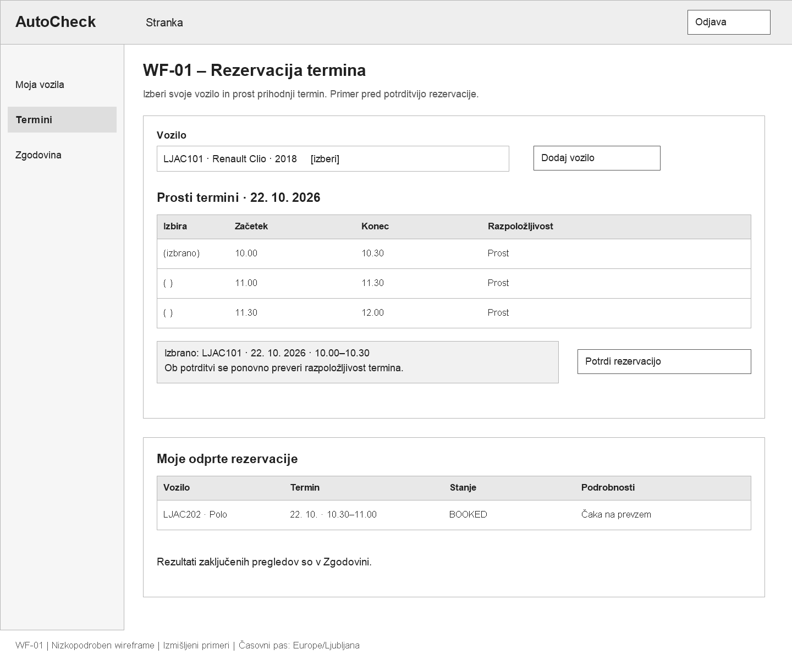
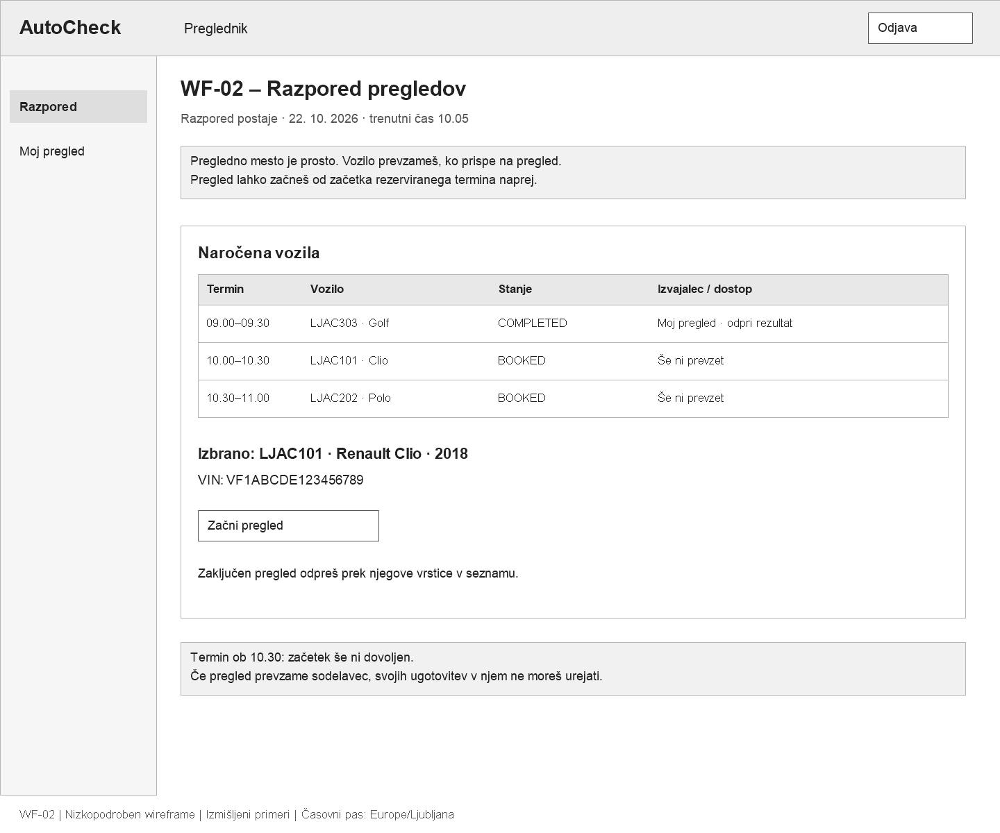
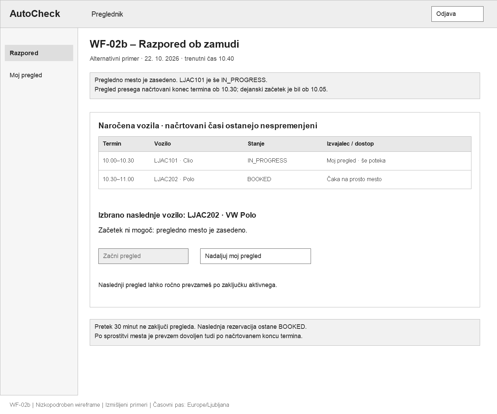
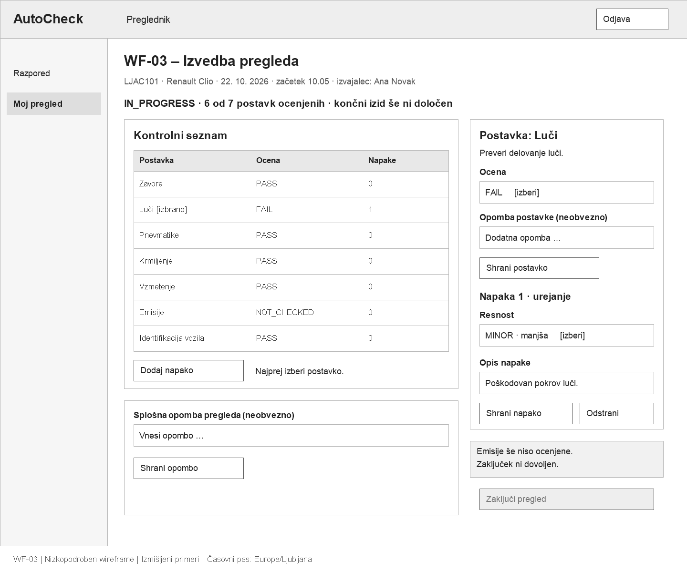
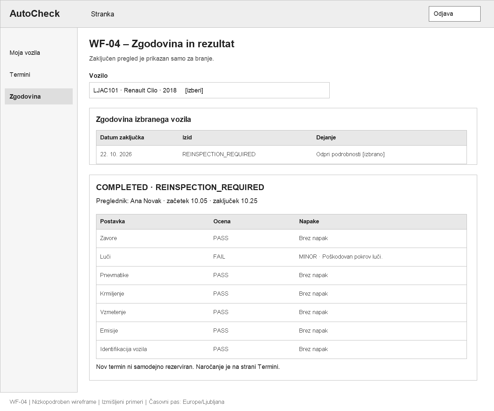
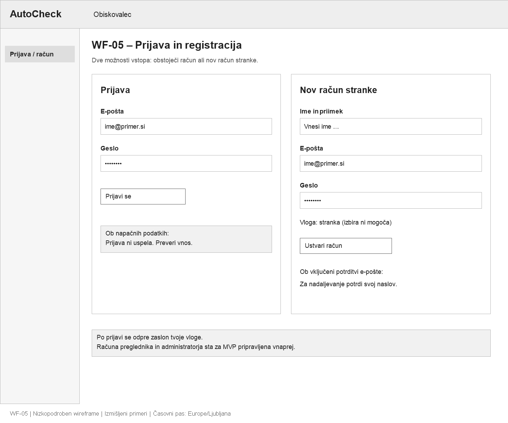
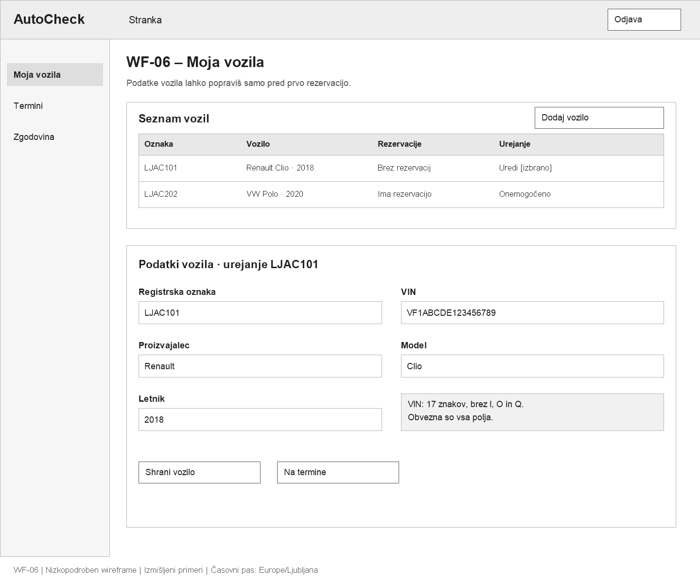
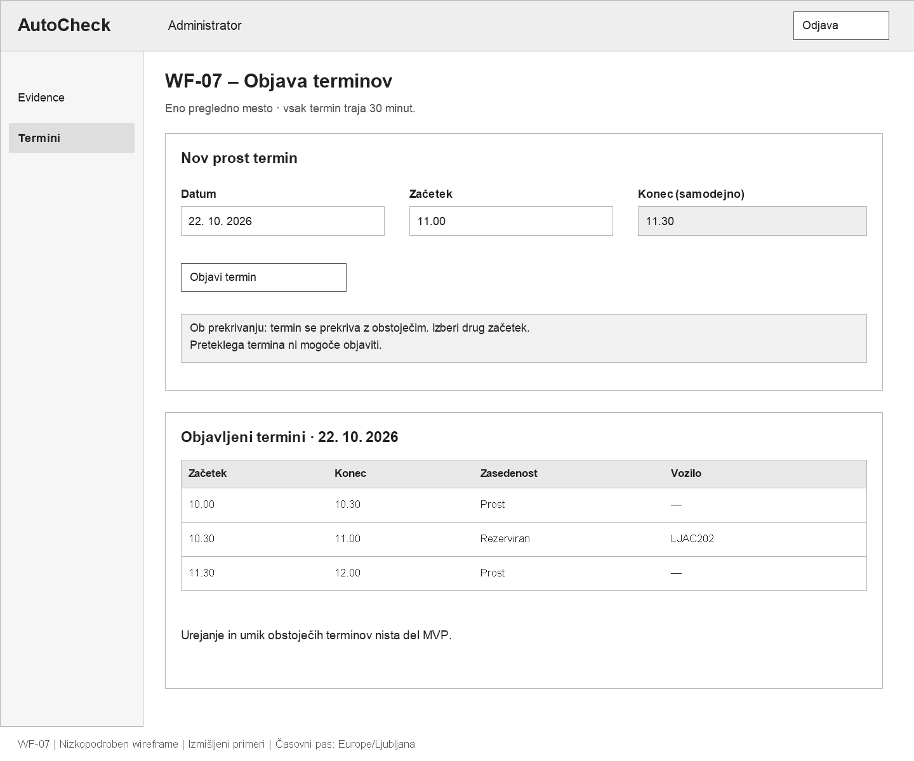
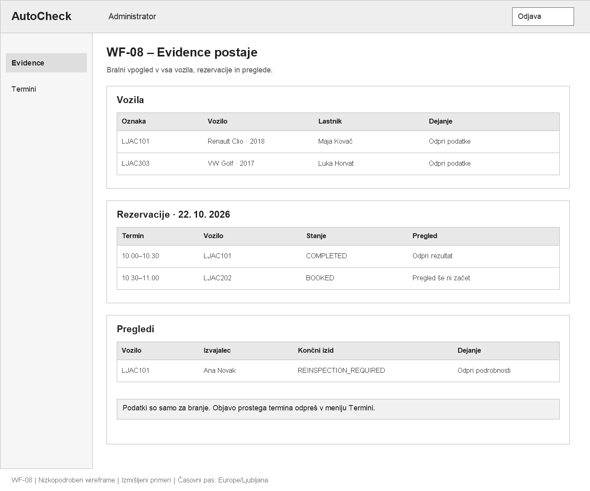

# AutoCheck – wireframe-i (2. naloga)

## Namen in skupna pravila

Osem osnovnih wireframov in različica razporeda ob zamudi WF-02b prikazujejo dogovorjeni MVP F01–F07 iz [dokumenta 02](02-funkcionalnosti-in-obseg.md) in podpirajo vseh 15 [uporabniških zgodb](05-uporabniske-zgodbe.md). Gre za statične načrte zaslonov, ne za implementacijo aplikacije. Besedila, uporabniki in vozila so izmišljeni primeri.

Vse slike uporabljajo belo ozadje, sive površine, črne oznake, isto glavo z vlogo in stransko navigacijo. Gumbi s sivim ozadjem in sivim besedilom so onemogočeni; razlog je zapisan ob njih. Izrazi »prost« in »rezerviran« pri terminu opisujejo njegovo zasedenost, ne novih stanj rezervacije.

Ohranjen je potek `BOOKED → IN_PROGRESS → COMPLETED`. Ocena postavke je `PASS`, `FAIL` ali `NOT_CHECKED`; napaka ima resnost `MINOR` ali `MAJOR`. Končni izid je `PASSED`, `FAILED` ali `REINSPECTION_REQUIRED` in se določi šele ob veljavnem zaključku. Ta projektna pravila ne predstavljajo uradne odločitve o registraciji vozila.

Predpostavke o navigaciji, izrecnem shranjevanju in potrditvi e-pošte so navedene v [uporabniških zgodbah](05-uporabniske-zgodbe.md#izhodišča-in-predpostavke). Datumi se prikazujejo v časovnem pasu `Europe/Ljubljana`. WF-01, WF-06 in WF-07 prikazujejo pripravo pred rezerviranim datumom, WF-02 stanje ob 10.05, WF-03 izvajanje po prevzemu, WF-04 in WF-08 pa stanje po zaključku. To niso sočasni posnetki baze.

### Povezave med zasloni

| Vloga | Pot po zaslonih |
| --- | --- |
| Stranka | WF-05 prijava → WF-06 vozila → WF-01 rezervacija in odprte rezervacije → po zaključku WF-04 zgodovina in rezultat. |
| Preglednik | WF-05 prijava → WF-02 razpored → prevzem → WF-03 izvedba → veljaven zaključek → bralni prikaz rezultata po vzorcu WF-04. |
| Administrator | WF-05 prijava → WF-08 evidence; WF-07 objava terminov; iz evidence bralni prikaz vozila ali pregleda. |

WF-04 je na sliki prikazan za stranko. Preglednik lahko enako vsebino vidi samo za svoje zaključene preglede, administrator za vse. Navigacija se pri tem prilagodi vlogi; pravice se ne razširijo. Administratorjev vpogled v aktiven pregled uporabi vsebino WF-03 v bralnem načinu, brez gumbov za urejanje in brez končnega izida.

## WF-01 – Rezervacija termina

**Uporabniška vloga:** Stranka.  
**Povezane zgodbe:** US-06, US-07; navigacija do US-03 in odjava US-02.



[Izvorna SVG datoteka](images/wf-01-rezervacija-termina.svg)

Zgornji del vsebuje izbiro lastnega vozila, seznam prostih prihodnjih terminov ter povzetek izbire. Spodnji del prikazuje obstoječe odprte rezervacije lastnih vozil. V prikazanem primeru je za LJAC101 izbran nov termin, LJAC202 pa že ima rezervacijo.

- **Dejanja in povezave:** »Dodaj vozilo« odpre WF-06; »Potrdi rezervacijo« shrani `BOOKED` in osveži seznam odprtih rezervacij na tem zaslonu. Meni »Zgodovina« odpre WF-04, »Odjava« WF-05.
- **Validacija:** brez vozila ali termina potrditev ni omogočena. Vozilo z odprto rezervacijo ni na voljo za novo rezervacijo. Če termin medtem postane zaseden ali se začne, se prikaže obvestilo in osveži izbor; dvojni zapis ne nastane.
- **Prazno stanje:** brez vozil se prikaže povezava za vnos vozila; brez prostih terminov obvestilo »Trenutno ni prostih terminov«; brez odprtih rezervacij obvestilo v spodnjem delu.
- **Omejitve:** stranka vidi samo svoje rezervacije. Ni odpovedi, prestavljanja, vpogleda v nedokončane ugotovitve ali ročnega spreminjanja stanja. Zamujen `BOOKED` ostane v seznamu.
- **Zamuda:** po načrtovanem začetku še neprevzetega termina se pri lastni rezervaciji ob osvežitvi prikaže »Termin se še ni začel; možna je zamuda«. Čas rezervacije ostane prvoten; podatki vozila, ki trenutno zaseda mesto, se stranki ne razkrijejo.

## WF-02 – Razpored pregledov

**Uporabniška vloga:** Preglednik.  
**Povezane zgodbe:** US-08, US-09; odjava US-02.



[Izvorna SVG datoteka](images/wf-02-razpored-pregledov.svg)

Zaslon prikazuje razpored celotne postaje in podatke izbranega naročenega vozila. Na sliki je ob 10.05 pregledno mesto prosto, rezervacija ob 10.00 pa še `BOOKED`, zato je njen prevzem dovoljen. Predhodni zaključen pregled pripada prijavljenemu pregledniku.

- **Dejanja in povezave:** izbira vrstice prikaže podatke vozila; »Začni pregled« uspešno prevzame izbrano rezervacijo in odpre WF-03. Povezava v vrstici lastnega zaključenega pregleda odpre bralni rezultat po vzorcu WF-04.
- **Druga dovoljena različica zaslona:** pri lastnem `IN_PROGRESS` je namesto začetka na voljo »Nadaljuj pregled« → WF-03. Pri pregledu drugega preglednika ni urejanja niti odpiranja njegovih ugotovitev.
- **Validacija:** pri terminu ob 10.30 začetek ob prikazanem času še ni dovoljen. Če obstaja katerikoli aktiven pregled, se novi začetki onemogočijo z razlogom. Strežnik pogoje ponovno preveri ob prevzemu, tudi pri sočasnem poskusu drugega preglednika.
- **Prazno stanje:** če ni rezervacij, se prikaže »Ni naročenih vozil«. Vnaprejšnje dodeljevanje pregledov zaposlenim ni del MVP.

### WF-02b – Razpored ob zamudi

**Uporabniška vloga:** Preglednik.  
**Povezane zgodbe:** US-08, US-09, US-12.



[Izvorna SVG datoteka](images/wf-02b-razpored-ob-zamudi.svg)

To je alternativni primer daljšega pregleda, ne nadaljevanje zaključenega primera na WF-04. Ob 10.40 pregled LJAC101 z načrtovanim terminom 10.00–10.30 in dejanskim začetkom ob 10.05 še traja. Naslednje vozilo LJAC202 za termin 10.30–11.00 ostaja `BOOKED`.

- »Začni pregled« za izbrano naslednjo rezervacijo je onemogočen, ker je pregledno mesto še zasedeno. Blokada velja za vse preglednike in tudi za neposreden API zahtevek.
- »Nadaljuj moj pregled« odpre aktivni pregled LJAC101 na WF-03. Če je izvajalec drug preglednik, tega dejanja ni.
- Po veljavnem zaključku prvega pregleda se ob osvežitvi omogoči ročni začetek naslednjega, če je ta še `BOOKED` in mesto prosto. Tudi po 11.00 ni potrebna nova rezervacija; shrani se dejanski začetek.
- Obvestilo o prekoračitvi ni novo stanje. Ni avtomatskega zaključka, prestavljanja terminov, predvidenega časa čakanja ali avtomatskega začetka naslednjega pregleda.

Podrobna pravila in časovni primer so v razdelku [Pregled, ki preseže načrtovani termin](05-uporabniske-zgodbe.md#pregled-ki-preseže-načrtovani-termin).

## WF-03 – Izvedba pregleda

**Uporabniška vloga:** Preglednik, ki je prevzel pregled.  
**Povezane zgodbe:** US-09, US-10, US-11, US-12; odjava US-02.



[Izvorna SVG datoteka](images/wf-03-izvedba-pregleda.svg)

Levo so kopirane postavke kontrolnega seznama, desno ocena, opomba in obrazec napake izbrane postavke. Spodaj sta splošna opomba in zaključek. Prikazan je shranjen primer s šestimi ocenjenimi postavkami: luči imajo `FAIL` in eno napako `MINOR`, emisije pa še `NOT_CHECKED`.

- **Dejanja:** izbira vrstice odpre njeno oceno in opombo. »Shrani postavko« shrani samo oceno in opombo izbrane postavke; »Shrani opombo« splošno opombo pregleda.
- **Napake:** »Dodaj napako« odpre prazen obrazec pri izbrani postavki `FAIL`. Izbira obstoječe napake odpre obrazec za popravek, kot na sliki. Izbirnik resnosti ponuja samo `MINOR` in `MAJOR`. »Shrani napako« shrani opis in resnost, »Odstrani« izbriše izbrano napako. Če jih je več, se vse izpišejo ob postavki in vsako lahko izberemo za urejanje.
- **Validacija napak:** prazen opis ali manjkajoča resnost preprečita shranjevanje napake. Po odstranitvi zadnje napake pri `FAIL` ali spremembi ocene v `PASS` ob preostalih napakah se pokaže neskladje; začasen zapis je dovoljen, zaključek ne.
- **Onemogočen zaključek:** na sliki so emisije neocenjene, zato je »Zaključi pregled« onemogočen z razlago. Enako velja za `FAIL` brez napake, `PASS` z napako ali neshranjene spremembe. Neposreden API zahtevek ne more obiti preverjanja shranjenih podatkov.
- **Veljaven zaključek in povezave:** ko so vse postavke ocenjene in skladne, se dejanje omogoči. Če emisije postanejo `PASS`, druge prikazane ugotovitve pa ostanejo enake, je izid `REINSPECTION_REQUIRED`. Sistem shrani `COMPLETED` in odpre bralni rezultat po vzorcu WF-04. Meni »Razpored« vrne WF-02; to samo po sebi ne zaključi pregleda.
- **Omejitve:** samo izvajalec aktivnega pregleda lahko spreminja podatke. Ni ročne izbire končnega izida ali dodajanja postavk predloge. Po zaključku urejevalni gumbi niso več na voljo.
- **Daljše izvajanje:** po načrtovanem koncu se lahko ob stanju izpiše »Pregled presega načrtovani konec termina«. Ocenjevanje ostane omogočeno; gumb za zaključek je odvisen od popolnosti podatkov, ne od poteka 30 minut. Mesto je do dejanskega zaključka zasedeno.

## WF-04 – Zgodovina in rezultat

**Uporabniška vloga:** Stranka; bralni prikaz rezultata se uporabi tudi za dovoljene preglede osebja.  
**Povezane zgodbe:** US-13, US-14; bralni dostop US-08 in US-15, rezultat zaključka US-12 ter odjava US-02.



[Izvorna SVG datoteka](images/wf-04-zgodovina-in-rezultat.svg)

Stranka izbere svoje vozilo, v seznamu njegov zaključen pregled in pod njim vidi shranjene ugotovitve. Primer nadaljuje WF-03 po uspešnem preverjanju emisij: postavka luči ostane `FAIL` z napako `MINOR`, zato je pregled `REINSPECTION_REQUIRED`, stanje rezervacije pa `COMPLETED`.

- **Dejanja in povezave:** izbira vozila osveži zgodovino, »Odpri podrobnosti« odpre izbrani rezultat. Meni »Termini« odpre običajno rezervacijo WF-01; ne obstaja ločen gumb za samodejni ponovni pregled.
- **Prikaz podatkov:** vidni so izvajalec, začetek, zaključek, izid, vse postavke in pripadajoče napake. Če so zapisane opombe postavk ali splošna opomba, se prikažejo ob pripadajoči vsebini; v primeru na sliki so prazne.
- **Prazno stanje:** brez zaključenih pregledov se prikaže obvestilo in ne prikazuje razdelka z rezultatom. Pri `PASSED` brez napak se prikaže »Napake niso bile ugotovljene«.
- **Omejitve:** nobeno polje ni urejevalno. Stranka ne vidi tujega ali aktivnega pregleda, preglednik vidi samo svoje preglede, administrator pa vse. `REINSPECTION_REQUIRED` ne ustvari rezervacije in ne spremeni `COMPLETED` nazaj v `BOOKED`.

## WF-05 – Prijava in registracija

**Uporabniška vloga:** Obiskovalec oziroma odjavljen uporabnik.  
**Povezane zgodbe:** US-01, US-02.



[Izvorna SVG datoteka](images/wf-05-prijava-in-registracija.svg)

Levi obrazec omogoča prijavo obstoječega računa, desni ustvarjanje računa stranke. Prikazana obvestila predstavljajo mesta za povratno informacijo; sporočilo o napačni prijavi se pokaže samo po neuspelem poskusu.

- **Dejanja in povezave:** »Prijavi se« odpre WF-06 za stranko, WF-02 za preglednika ali WF-08 za administratorja. »Ustvari račun« izvede registracijo prek Supabase Auth in ob vključeni potrditvi e-pošte prikaže nadaljnja navodila.
- **Validacija:** manjkajoča polja ali napačna oblika e-pošte preprečijo veljavno oddajo. Napačna prijava prikaže obvestilo brez dostopa do zaščitenih podatkov; ponovljena registracija ne ustvari drugega računa.
- **Omejitve:** vloge ni mogoče izbirati. Osebje uporablja predhodno pripravljene račune. Ponastavitev gesla, socialne prijave in upravljanje osebja niso dodani v MVP.

## WF-06 – Moja vozila

**Uporabniška vloga:** Stranka.  
**Povezane zgodbe:** US-03, US-04; odjava US-02.



[Izvorna SVG datoteka](images/wf-06-moja-vozila.svg)

Seznam lastnih vozil je nad obrazcem za vnos oziroma popravek. Na sliki LJAC101 še nima rezervacije in je odprt za urejanje, LJAC202 pa jo že ima, zato ga ni mogoče spreminjati.

- **Dejanja in povezave:** »Dodaj vozilo« prikaže isti obrazec s praznimi polji, »Uredi« ga napolni s podatki izbranega vozila. »Shrani vozilo« osveži seznam, »Na termine« odpre WF-01. Meni »Zgodovina« odpre WF-04.
- **Validacija:** obvezna so vsa prikazana polja; veljajo format VIN, enoličnost registrske oznake in VIN ter razpon letnika iz US-03. Napaka se izpiše ob polju oziroma shranjevanju, brez izgube prej shranjenih podatkov.
- **Onemogočeno urejanje:** katerakoli obstoječa rezervacija, tudi zaključena, prepreči popravke. Če nastane med urejanjem, strežnik ob shranjevanju spremembo zavrne.
- **Omejitve:** ni izbire lastnika, prenosa lastništva ali brisanja vozila. Administrator lahko podatke vozila iz WF-08 odpre v bralnem prikazu teh polj, brez obrazca za spremembe.

## WF-07 – Objava terminov

**Uporabniška vloga:** Administrator.  
**Povezane zgodbe:** US-05; odjava US-02.



[Izvorna SVG datoteka](images/wf-07-objava-terminov.svg)

Zgornji obrazec določa datum in začetek; konec se samodejno izračuna kot začetek + 30 minut in je samo za branje. Spodnji seznam kaže objavljene termine in zasedenost. Primer prikazuje še neobjavljen termin 11.00–11.30 med obstoječima terminoma.

- **Dejanja in povezave:** »Objavi termin« ustvari prost termin in osveži seznam. Meni »Evidence« odpre WF-08. Strankam je novi prihodnji termin na voljo na WF-01.
- **Validacija:** manjkajoč ali neveljaven datum, začetek, ki ni v prihodnosti, oziroma prekrivanje s katerimkoli obstoječim terminom prepreči objavo. Stik dveh terminov na meji je dovoljen. Obvestilo v sivem polju ponazarja prostor za sporočilo ob napaki; izbrani primer 11.00–11.30 se ne prekriva.
- **Omejitve:** termini pripadajo enemu preglednemu mestu. Ni brisanja, urejanja obstoječih terminov, ponavljajočih se terminov ali naprednega koledarja. Stranka in preglednik zaslona ne moreta uporabljati za objavo.

## WF-08 – Administratorske evidence

**Uporabniška vloga:** Administrator.  
**Povezane zgodbe:** US-15; povezava do US-05 in odjava US-02.



[Izvorna SVG datoteka](images/wf-08-administratorske-evidence.svg)

Zaslon združuje bralne sezname vseh vozil, rezervacij in pregledov postaje. Ne vsebuje statistike. Primer pokaže vozila različnih strank, zaključen pregled LJAC101 in še nezačeto rezervacijo LJAC202.

- **Dejanja in povezave:** »Odpri podatke« odpre bralni prikaz polj vozila iz WF-06, »Odpri rezultat« oziroma »Odpri podrobnosti« pa prikaz pregleda. Zaključen pregled uporabi vsebino WF-04, aktiven vsebino WF-03 brez urejanja. Meni »Termini« odpre WF-07.
- **Manjkajoč pregled:** pri `BOOKED` je namesto povezave na pregled prikazano »Pregled še ni začet«. Prazen razdelek pokaže, da v njem še ni zapisov.
- **Omejitve:** ni gumbov za začetek, ocenjevanje, spreminjanje napak ali zaključek. Administratorski bralni dostop ne pomeni pravice spreminjati strokovnih ugotovitev. Upravljanje računov, predloge in statistika ostajajo zunaj MVP.

## Izvorne datoteke in ponovna izdelava

Vse slike so programsko narisane pri velikosti **1440 × 1200**. PNG vsebujejo ostro izrisano besedilo, SVG pa urejevalne besedilne in geometrijske elemente. Obe obliki nastaneta iz istega opisa in uporabljata iste koordinate. Najmanjša velikost besedila je 17 px.

Izvor je [generate-wireframes.ps1](tools/generate-wireframes.ps1). V okolju Windows s PowerShell in `System.Drawing` se slike ponovno izdelajo iz korena projekta:

```powershell
powershell -NoProfile -ExecutionPolicy Bypass -File .\docs\tools\generate-wireframes.ps1
```

Skripta ustvari samo datoteke `wf-*.png` in `wf-*.svg` v `docs/images/`; ne spreminja aplikacije, dokumentacije 1. naloge ali obstoječega diagrama procesa. Pri izrisu preveri širino besedila in meje platna. Ročne spremembe SVG je treba prenesti tudi v skripto, če želimo ohraniti enak PNG ob ponovni izdelavi.
